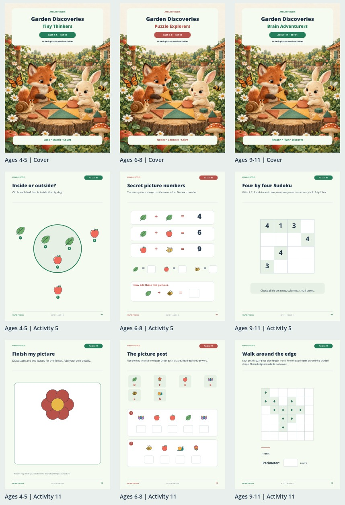
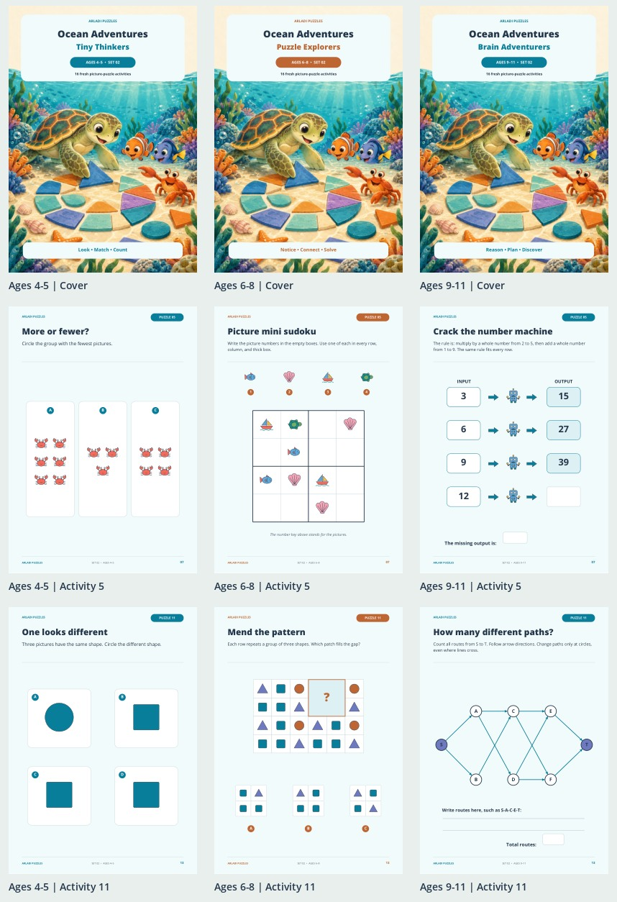
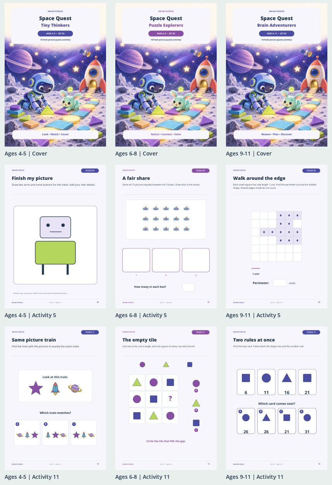
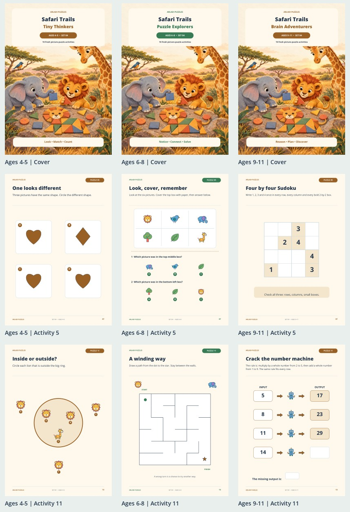
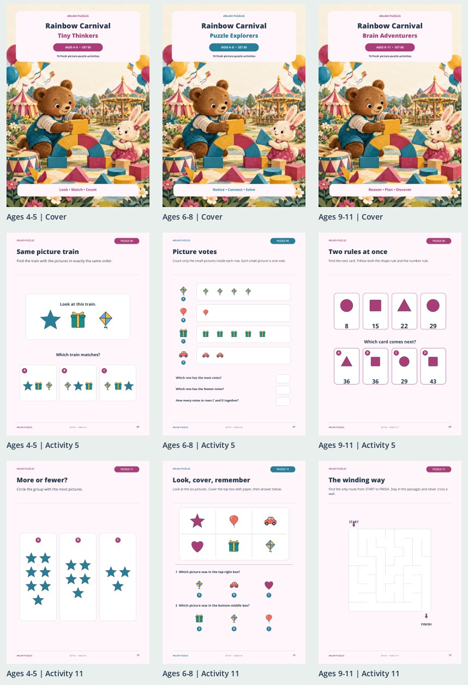

# Arladi Puzzles

A full-color collection of 15 printable puzzle books: five themes, three age groups, and 240 activities.

[Download the complete collection (ZIP)](Arladi_Puzzles_Complete_Collection.zip?raw=true) · [Collection guide (PDF)](Arladi_Puzzles_Collection_Guide.pdf?raw=true)

## Choose an age group

| Ages | Series | Focus |
| --- | --- | --- |
| 4–5 | Tiny Thinkers | Look, match, count, and explore positions; grown-ups can read the directions. |
| 6–8 | Puzzle Explorers | Patterns, picture numbers, codes, routes, and simple logic. |
| 9–11 | Brain Adventurers | Number patterns, spatial challenges, data, and logic with several steps. |

## Download individual books

| Set and theme | Ages 4–5 | Ages 6–8 | Ages 9–11 |
| --- | --- | --- | --- |
| 01 · Garden Discoveries | [Tiny Thinkers](books/S01_Garden_Tiny_Thinkers_Ages_4-5.pdf?raw=true) | [Puzzle Explorers](books/S01_Garden_Puzzle_Explorers_Ages_6-8.pdf?raw=true) | [Brain Adventurers](books/S01_Garden_Brain_Adventurers_Ages_9-11.pdf?raw=true) |
| 02 · Ocean Adventures | [Tiny Thinkers](books/S02_Ocean_Tiny_Thinkers_Ages_4-5.pdf?raw=true) | [Puzzle Explorers](books/S02_Ocean_Puzzle_Explorers_Ages_6-8.pdf?raw=true) | [Brain Adventurers](books/S02_Ocean_Brain_Adventurers_Ages_9-11.pdf?raw=true) |
| 03 · Space Quest | [Tiny Thinkers](books/S03_Space_Tiny_Thinkers_Ages_4-5.pdf?raw=true) | [Puzzle Explorers](books/S03_Space_Puzzle_Explorers_Ages_6-8.pdf?raw=true) | [Brain Adventurers](books/S03_Space_Brain_Adventurers_Ages_9-11.pdf?raw=true) |
| 04 · Safari Trails | [Tiny Thinkers](books/S04_Safari_Tiny_Thinkers_Ages_4-5.pdf?raw=true) | [Puzzle Explorers](books/S04_Safari_Puzzle_Explorers_Ages_6-8.pdf?raw=true) | [Brain Adventurers](books/S04_Safari_Brain_Adventurers_Ages_9-11.pdf?raw=true) |
| 05 · Rainbow Carnival | [Tiny Thinkers](books/S05_Carnival_Tiny_Thinkers_Ages_4-5.pdf?raw=true) | [Puzzle Explorers](books/S05_Carnival_Puzzle_Explorers_Ages_6-8.pdf?raw=true) | [Brain Adventurers](books/S05_Carnival_Brain_Adventurers_Ages_9-11.pdf?raw=true) |

## Download a themed set

Each set ZIP contains all three age groups.

- [Garden Discoveries — three books (ZIP)](sets/S01_Garden_Set.zip?raw=true)
- [Ocean Adventures — three books (ZIP)](sets/S02_Ocean_Set.zip?raw=true)
- [Space Quest — three books (ZIP)](sets/S03_Space_Set.zip?raw=true)
- [Safari Trails — three books (ZIP)](sets/S04_Safari_Set.zip?raw=true)
- [Rainbow Carnival — three books (ZIP)](sets/S05_Carnival_Set.zip?raw=true)

## Inside every book

Each book has 24 A4 portrait pages:

- Cover and a welcome page.
- 16 illustrated activity pages (pages 3–18).
- Four answer pages with explanations (pages 19–22).
- A certificate and back cover.

Print in color at actual size / 100%, or choose “fit” if your printer needs extra margins. Work at a comfortable pace with a pencil. The age ranges are a guide; choose the level that suits the child.

## A look inside

[File checksums](SHA256SUMS.txt)
